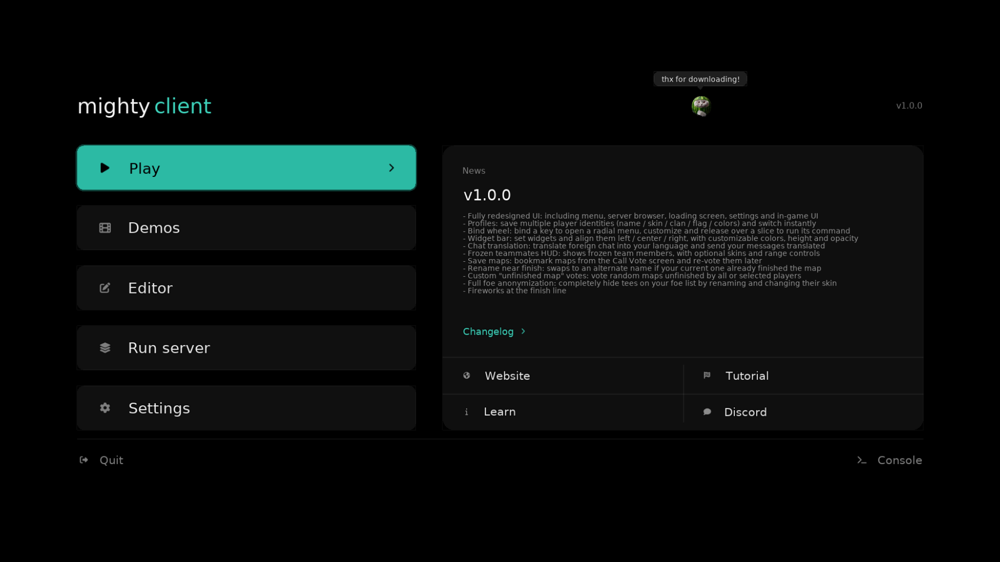
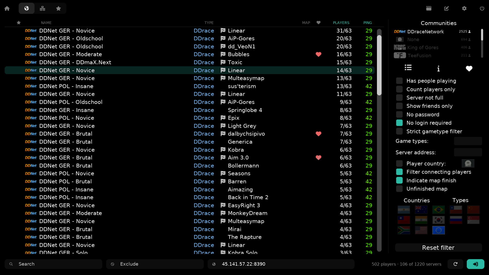
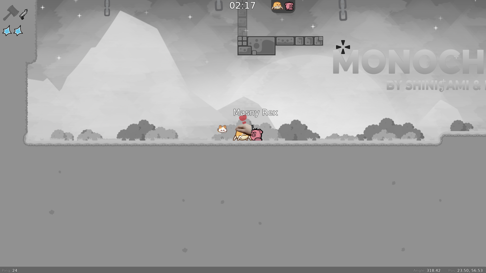

[](https://ddnet.org)

The **mighty client** is a fork of the [DDraceNetwork](https://github.com/ddnet/ddnet) client, which itself is a modification of [Teeworlds](https://github.com/teeworlds/teeworlds). It enhances the gameplay experience a lot by adding important features like forcing the maodie skin on all players, placing twinbops that wait for you at the finish line and showing advertisements during the game (plz dont turn them off).

<p align="center">
  
  
</p>

## List Of Features

- **Redesigned UI**
- **Enhanced vote menu**
- **Widget bar** that displays clock, FPS, position, angle and more.
- **Player profiles**
- **Skin blocking**
- **Incoming and outgoing chat translation**
- **Block spam bots** who join, spam and quickly leave again
- **Bind wheel**
- **Fast input** (copied from [TClient](https://github.com/TaterClient/TClient))
- **Fast practice**
- **Frozen teammates HUD** (copied from [TClient](https://github.com/TaterClient/TClient)).
- **Display if another tee is trying to hammer/hook while being freezed**
- **Automatically rename before finish**
- **Hide milliseconds for race times**
- **Fully hide tees on your foe list**
- **Save maps**
- **Save team codes**
- **Companion pet** (adjusted from [TClient](https://github.com/TaterClient/TClient)).
- **Accessories**
- **Mini-games** against other client user, using my own emoji protocol, without the need of any third party server
- **Additional skin provider**

If you want to **enhance your gameplay** even more, these are the **most important features** you definitely **have to enable**:
- **Force maodie skin to every tee**
- **In-game advertisements/quotes**
- **Petting hand**
- **Fat tee** when someone writes fat in chat
- **Giant maodie walking over the screen**
- **Upside down tees**.
- **Twinbops waiting at the finish line**



## Download
Get the **latest version** of the mighty client from the **[releases page](https://github.com/miightyowl/mighty-client/releases)**.

## Building

The mighty client builds **exactly like DDNet**. First clone this repository:

```sh
git clone https://github.com/miightyowl/mighty-client.git
```

Then follow the official DDNet build instructions for your platform **[here](https://github.com/ddnet/ddnet#dependencies-on-linux--macos)**.

## Credits

- [DDNet](https://github.com/ddnet/ddnet): the base client this fork is built on.
- [TClient](https://github.com/TaterClient/TClient): for several reworked or copied features listed above.
- User 咩咩咩啊 for creating the beautiful maodie skin!!
